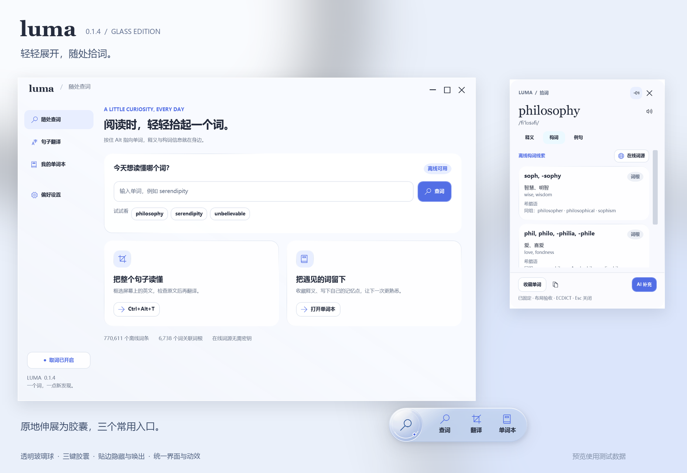

# Luma 拾词

一个常驻 Windows 桌面的英语学习助手。按住 Alt 指向单词查词，用快捷键框选英文并翻译，把遇见的词留进本地单词本。



## 下载与安装

在 [Releases](https://github.com/No-thanks-237/luma-English-desktop/releases/latest) 下载：

- **Luma-0.1.4-Setup-x64.exe**：安装版，适合日常使用。默认安装到当前用户目录，提供开始菜单与卸载入口，桌面快捷方式可选。
- **Luma-0.1.4-Windows-x64.zip**：便携版，完整解压后打开 `Luma.exe`，不要只复制 exe。

支持 Windows 10/11 x64，自带 .NET 运行时。其他电脑如无法加载 OCR 原生库，可安装 [Microsoft Visual C++ x64 运行库](https://aka.ms/vs/17/release/vc_redist.x64.exe)。安装包暂未代码签名。

## 使用

| 功能 | 默认操作 |
|---|---|
| 鼠标指向取词 | 按住 Alt，停留约 450 ms |
| 立即查鼠标处单词 | Ctrl+Alt+W |
| 框选句子翻译 | Ctrl+Alt+T |
| 暂停或恢复取词 | Ctrl+Alt+Space |
| 收起词卡、胶囊或框选 | Esc |
| 悬浮球 | 单击展开查词、翻译、单词本；拖动移动 |
| 贴边隐藏 | 拖到任一边缘，闲置后缩入边缘；鼠标靠近唤出 |

关闭主窗口后继续驻留托盘；托盘右键菜单可以完全退出。快捷键、停留时间、词卡内容、自动隐藏与动效均可在设置里调整。

## 功能

- UI Automation 取词优先，本地 Tesseract OCR 兜底。
- 770,611 个 ECDICT 离线词条，支持词形查询。
- 内置 611 条词根词缀记录，按明确例词关联 6,738 个英文单词；不随意按子串拆词。
- 维基词典官方 API 提供英语词源，保留来源与许可，缓存后可离线读取。
- DeepSeek 和 Chat Completions 格式的 OpenAI 兼容翻译接口，密钥在软件设置中填写。
- 本地单词本、学习笔记、CSV 导出、翻译历史与 Windows 英语语音朗读。
- 透明玻璃球、三键胶囊、四边吸附隐藏；珍珠白与冰蓝界面，可减少动态效果。

## 0.1.4 修复

- 标题栏空白处和品牌处均可拖动；支持双击最大化、最大化后拖动还原，窗口按钮正常点击。
- 胶囊使用固定尺寸的透明窗口，在内部伸缩绘制，修复贴边收回时闪烁；展开与收回保持球心位置。
- 保留四边吸附隐藏与唤出，收回后的透明空白区域不会拦截鼠标。
- 提供当前用户安装包与便携包。

## 数据与接口

用户数据位于 `%LOCALAPPDATA%\Luma`，卸载会保留。API 密钥通过当前 Windows 用户的 DPAPI 加密；首次使用需自行配置服务商与密钥。截图不上传，只有主动翻译或 AI 补充时才发送相应文本，在线词源只发送单词。

Google Cloud / Azure 官方翻译适配器尚未接入。OCR 与长词拼写校正可能出错，可手动修改原文。真实付费 AI 账户未做端到端调用验证，自动检查使用本地模拟接口。

## 构建

需要 .NET 8 SDK；首次还原需要网络。

```powershell
.\build.ps1
# 可选：安装 Inno Setup 6，生成 dist/ 下的安装包
.\build.ps1 -InstallerCompiler 'C:\Program Files (x86)\Inno Setup 6\ISCC.exe'
```

源码在 `src/`，发布程序在 `app/`；编译输出不加入 Git。安装脚本在 `installer/Luma.iss`。

```powershell
.\app\Luma.exe --self-test C:\path\to\isolated-test-output
.\app\Luma.exe --ui-preview --data-dir C:\path\to\isolated-preview-data --ui-audit C:\path\to\ui-audit-output
```

本版通过 17 项核心检查、64 项界面检查，包括标题栏原生命中、四边收回动画逐帧窗口与球心稳定、透明区域鼠标穿透。报告在 `test-results.json` 和 `ui-test-results.json`。部分多显示器 / DPI 验证属于几何测试，未穷尽硬件组合。

安装与卸载另通过 5 项检查，安装后的程序再次通过 17 项核心检查，原有用户数据保持不变；详见 `installer-test-results.json`。

详见 [使用说明](使用说明.md)、[验收记录](验收记录.md) 和 [第三方组件与许可](第三方组件.md)。
